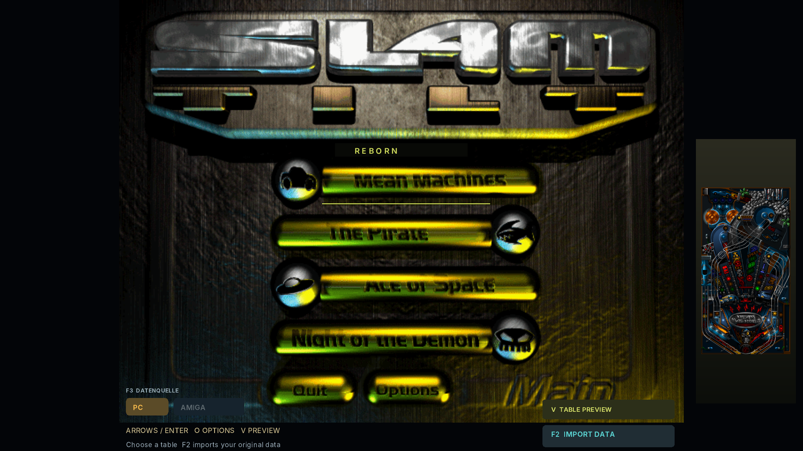
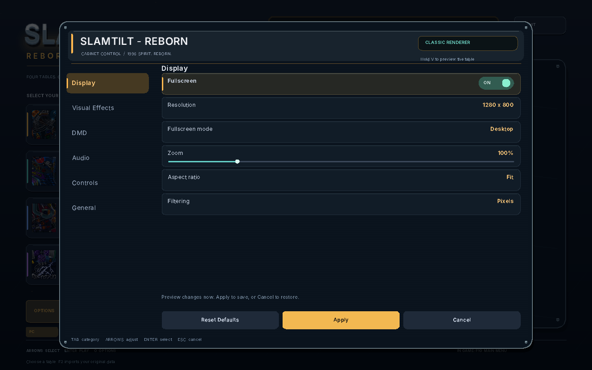
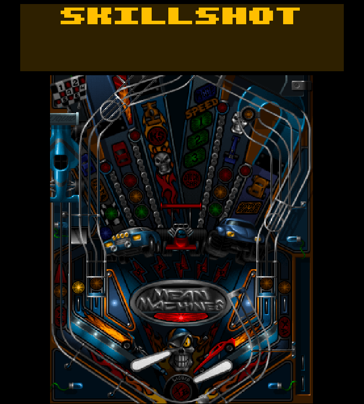
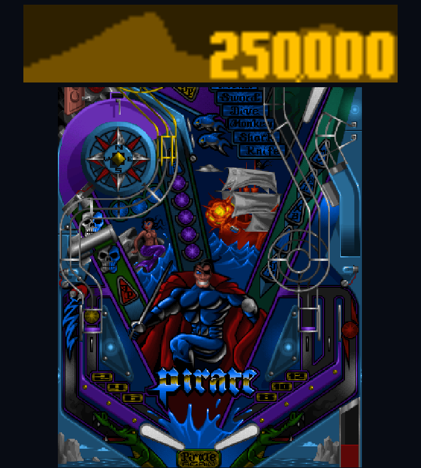
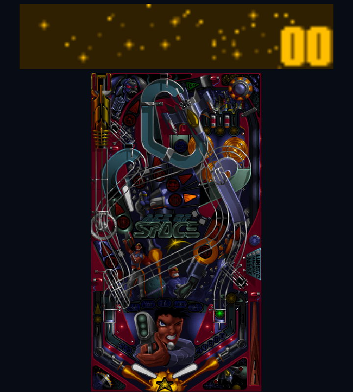
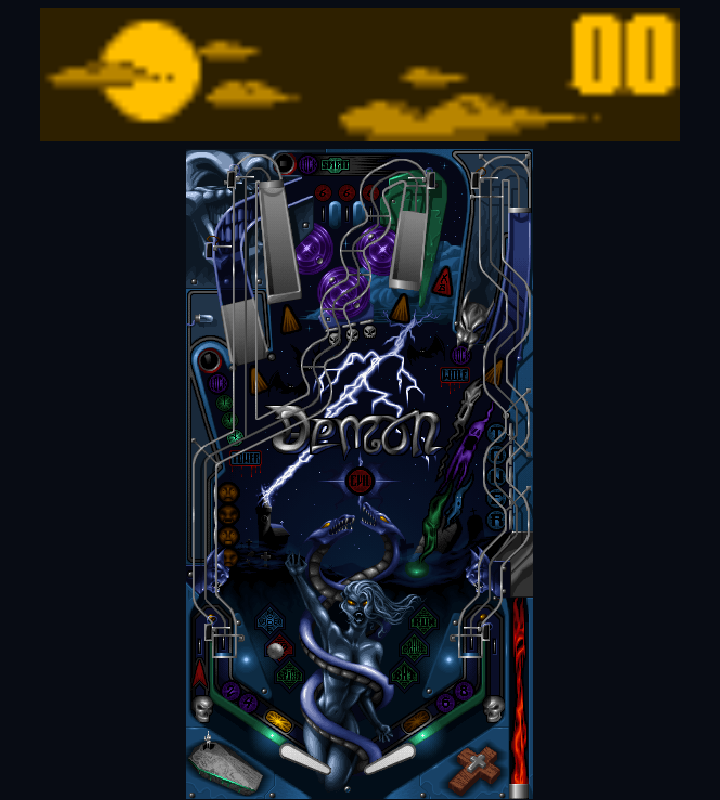

# Slamtilt – Reborn

**Mean Machines · The Pirate · Ace of Space · Night of the Demon**

Four classic pinball tables with an original-inspired menu, original artwork and sound, configurable controls, display options and a movable, colored DMD.

Bring your own original game files. Downloads include no original DAT files or Amiga disk images.

## Download and play

[Latest packaged release: version 1.3](https://github.com/Baulehrer/slamtilt-reborn/releases/tag/v1.3). The current source tree is version 1.4:

| Download | Start here |
| --- | --- |
| Windows installer | Run `setup.exe`; installs for your user account. |
| Windows portable ZIP | Extract everything, then run `bin/slamtilt.exe`. |
| Linux AppImage | Make executable and launch. Requires glibc2.34 or newer. |
| Linux portable TAR.XZ | Extract and run `./slamtilt-reborn`; smaller download. |
| Browser preview · single HTML | Open locally, then choose your game files. Requires WebAssembly JSPI. |
| Linux ARM64 preview | Extract and run `./slamtilt-reborn`. Batocera instructions included. |

Windows packages are **unsigned**; SmartScreen may show a warning. Check `SHA256SUMS` before running downloads.

## Your game files

Native builds: press **F2 / Import Original Data**. Browser: **Choose game files**.

- **Windows:** `MAIN.DAT` plus your table files: `MEAN.DAT`, `PIRATE.DAT`, `SPACE.DAT`, `DEMON.DAT`. No original EXE needed. `MENU.DAT` is optional and supplies the original menu artwork.
- **Amiga:** all **five supported retail v1.224 DLM ADFs**. See [supported disks](docs/amiga-adf-import.md).

Files stay local. Amiga data uses shared native gameplay; exact original Amiga physics equivalence is unverified.

Native controller support for the menu and all four tables, saved button mappings and the Batocera bootstrap are included in **1.1**: [controller guide](docs/controllers.md).

[Changelog](CHANGELOG.md) · The browser download is a single offline HTML file, about 3 MB.

## Controls and options

**Shift** flippers · **Enter** launch · **Alt / Space** nudge · **R** new game · **Esc** options · **F10** table menu.

Choose fullscreen, zoom, aspect ratio, filtering, DMD placement, sound levels and controls. Advanced GPU filters depend on the build; Windows and browser packages use compatible rendering.

| Mean Machines | The Pirate |
| --- | --- |
|  |  |
| **Ace of Space** | **Night of the Demon** |
|  |  |

The compact browser build passes offline/import/play/fullscreen tests in Chromium, Vivaldi and Brave. Windows is tested under Wine; ARM64 under QEMU. Physical Windows and Raspberry Pi/Batocera hardware remain unverified. Screenshots show software rendering.

Build from source: [instructions](docs/building.md). Distribution recipes: [packaging](packaging/README.md). Earlier technical notes: [development notes](docs/development-notes.md).
