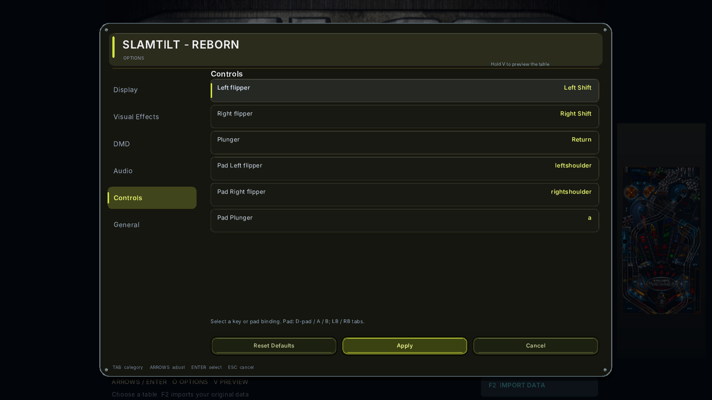

# Native controllers — version 1.1

One SDL3 gamepad adapter serves the main/options menus and all four native tables.
Recognized controllers work automatically; keyboard and mouse remain available.
Controller support is included in the native 1.1 downloads. Version 1.0 remains unchanged.
Run `build/native/slamtilt` when building from source; ARM64 is still a hardware-unverified preview.

| Control | Table | Menu/options |
| --- | --- | --- |
| LB / RB | Left/right flipper | Previous/next options category |
| South / A | Original launch/Enter | Select |
| East / B | Nudge up where supported | Back/cancel |
| West / X, North / Y | Table-specific actions where supported | Switch PC/Amiga source, import picker |
| D-pad / left stick | Original nudge actions where supported | Navigate; held directions repeat |
| RT | Pull, then release to launch | — |
| Start | Options | Open/close options |
| Back / Select | Return to table menu | Back/cancel |

In **Options → Controls**, select a `Pad ...` row, press a button, then Apply.
Choosing an occupied button swaps the two assignments. Start/Back are reserved;
they cancel binding capture. Menu navigation stays fixed even after rebinding
in-game actions. Old version1 options files keep working with default pad binds.

The trigger meter displays its real position. Launch arms above roughly55% and
fires once on release below roughly15%; it uses the existing digital launch
handler and original fixed force. It is not a variable-strength physics model.
Focus loss, menu transitions, remapping and disconnect release held actions.
Controls must return to neutral before rearming, including after a background
release that SDL did not deliver as an event.

Custom initials and desktop file dialogs may still need keyboard/mouse.
The [Batocera data-folder bootstrap](../packaging/batocera/README.md) avoids the
initial OS picker. Do not add a second pad2key layer on top of native mapping.

## Verification

- `gamepad_input`: six virtual-SDL contract groups, also passed under AArch64 QEMU.
- `tools/verify_gamepad_frontends.py`: real native menu and four gameplay frontends;
  controller-only ball launch, both native flipper poses, options, focus release
  and Back return. Mean/Space use RT release; Pirate/Demon use South/A.
- Batocera launcher:14 shell/stub scenarios plus actual native four-table DAT import.
- ARM64 package: compiled Linux/HIDAPI/virtual controller support, dummy menu,
  actual DAT first import, all four table CPU smokes, virtual trigger/button and audio probes.

These are controlled tests, not physical controller latency, Pi graphics/audio,
Bluetooth or a Batocera board-image acceptance. Those hardware checks remain open.

Local artifacts: `build/controller-acceptance/report.json`,
`build/native/gamepad-input.json`, `build/arm64-controller-candidate/acceptance.json`.

